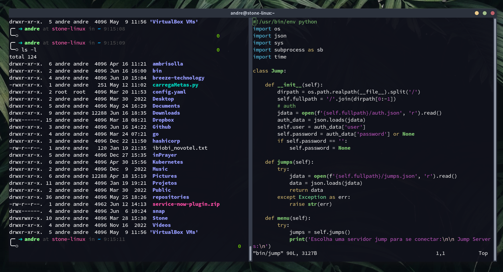

# Brisa - Oh My Zsh Theme

A clean and informative Oh My Zsh theme based on the original "fino-time" theme.



## Features

- **User & Host Display** - Shows your username and machine name
- **Git Integration** - Branch name with dirty/clean status indicators (✘✘✘ / ✔)
- **Python Virtualenv** - Displays active virtual environment
- **Ruby Version** - Shows current Ruby version (if applicable)
- **Exit Code** - Visual feedback for last command success/failure
- **Time Display** - Current time on the right side of the prompt
- **Special Git Indicator** - Unique symbol (⠠⠵) when inside a git repository

## Installation

### Prerequisites

Make sure you have [Oh My Zsh](https://ohmyz.sh/) installed.

### Linux & macOS

**Option 1: Using Make (Recommended)**

```bash
git clone https://github.com/tarcisioandrademiranda/oh-my-zsh-brisa-theme.git
cd oh-my-zsh-brisa-theme

make install-ohmyzsh

make install
```

To uninstall:
```bash
make uninstall
```

**Option 2: Manual Installation**

```bash
git clone https://github.com/tarcisioandrademiranda/oh-my-zsh-brisa-theme.git

cp oh-my-zsh-brisa-theme/brisa.zsh-theme ~/.oh-my-zsh/themes/
```

**Option 3: Direct Download**

```bash
curl -o ~/.oh-my-zsh/themes/brisa.zsh-theme https://raw.githubusercontent.com/tarcisioandrademiranda/oh-my-zsh-brisa-theme/main/brisa.zsh-theme
```

### Activate the Theme

1. Open your `.zshrc` file:
   ```bash
   nano ~/.zshrc
   ```

2. Find the line starting with `ZSH_THEME` and change it to:
   ```bash
   ZSH_THEME="brisa"
   ```

3. Save the file and reload your shell:
   ```bash
   source ~/.zshrc
   ```

## Prompt Structure

```
╭─ ➜ username at hostname in ~/current/directory on branch-name ✔ 14:30:00
╰─(venv) ⠠⠵
```

| Element | Description |
|---------|-------------|
| `➜` | Green if last command succeeded, red if failed |
| `username` | Current user |
| `hostname` | Machine name |
| `~/path` | Current directory |
| `branch-name` | Git branch (if in a repo) |
| `✔` / `✘✘✘` | Git clean / dirty status |
| `(venv)` | Python virtual environment (if active) |
| `⠠⠵` / `○` | Git repo indicator / normal directory |

## Customization

You can set a custom machine name by creating a file:

```bash
echo "my-custom-name" > ~/.box-name
```

## License

[MIT License](LICENSE)

## Contributing

Feel free to open issues or submit pull requests!
